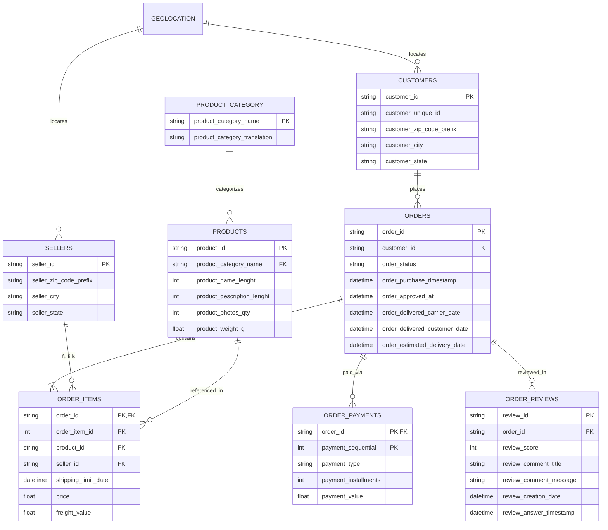

# 📦 Brazilian E-Commerce (Olist) Sales & Delivery Performance Analysis

[](https://public.tableau.com/views/OlistE-CommerceAnalysis_17941327576920/Dashboard1?:language=en-GB&publish=yes&:sid=&:redirect=auth&:display_count=n&:origin=viz_share_link)
[](https://www.mysql.com/)
[](https://www.sqlite.org/)
[](LICENSE)
[](https://www.kaggle.com/datasets/olistbr/brazilian-ecommerce)

An end-to-end SQL and Business Intelligence portfolio project analyzing **sales trends**, **customer purchasing behavior**, **logistics performance**, and **customer satisfaction** across Brazilian e-commerce orders from 2016 to 2018 using the **Olist Public Dataset**.

---

### 🔗 Interactive BI Dashboard
> **Explore the interactive dashboard on Tableau Public:**  
> 🌐 **[View Live Tableau Dashboard](https://public.tableau.com/views/OlistE-CommerceAnalysis_17941327576920/Dashboard1?:language=en-GB&publish=yes&:sid=&:redirect=auth&:display_count=n&:origin=viz_share_link)**

---

## 📌 Executive Summary

This project investigates **99,441 orders** from **96,096 unique customers** across Brazil, served by **289 active sellers** spanning **71 product categories**, generating **R$ 13.22 million in delivered item revenue**.

Through advanced SQL querying (CTEs, conditional aggregation, date-time manipulation) and Tableau visual analytics, this project reveals:
1. **The Fulfillment-Satisfaction Cliff**: On-time orders average **4.29 / 5.00 stars**, but late deliveries plummet to **2.27 / 5.00 stars** (a **47.1% rating penalty**), making delivery delays the single biggest driver of customer churn.
2. **Extreme Geographic Concentration**: The Southeast region dominates Brazilian e-commerce. **São Paulo (SP)** alone accounts for **R$ 5.07M in delivered revenue (38.3%)** and **41,746 orders (42.0%)**.
3. **The Northern Logistics Tax**: Customers in northern and northeastern states endure severe delivery friction. While São Paulo customers pay only **13.85%** of item price in freight with an **8.70-day** transit time, customers in **Roraima (RR)** pay **28.08%** in freight with an average wait of **29.34 days**.
4. **Punctuality & SLA Buffers**: While **93.23%** of orders arrive on or before the estimated delivery date, actual deliveries arrive an average of **11.90 days ahead of schedule**, indicating conservative SLA estimation.
5. **Peak Sales Patterns**: Purchasing volume surges during weekday working hours—peaking on **Mondays (16,196 orders)** and **Tuesdays (15,963 orders)** around **16:00 (4:00 PM)**. Monthly revenue peaked in **November 2017 (R$ 1,003,862.14)** driven by Black Friday.

---

## 📊 Key Metrics & High-Level KPIs

| Metric | Value | Description |
| :--- | :--- | :--- |
| **Total Orders** | `99,441` | Total purchases registered between Sep 2016 and Oct 2018 |
| **Delivered Orders** | `96,478` | Successfully delivered orders (97.0% completion rate) |
| **Unique Customers** | `96,096` | Unique customer identifiers across all Brazilian states |
| **Delivered Revenue** | `R$ 13,221,498.11` | Total merchandise value of fulfilled & delivered items |
| **Average Order Value (AOV)** | `R$ 137.04` | Average item spend per delivered order |
| **Total Order Items** | `112,650` | Individual item units purchased |
| **National Avg Delivery Duration** | `12.50 days` | Duration from order purchase to customer delivery |
| **Average Delivery Buffer** | `11.90 days` | Days orders arrive ahead of estimated promise date |
| **On-Time Delivery Rate** | `93.23%` | 89,944 shipments arrived on or before expected date |
| **Late Delivery Rate** | `6.77%` | 6,534 shipments delivered past customer expectation |
| **On-Time Average Review** | `4.29 / 5.00` | High satisfaction when logistics promises are met |
| **Late Average Review** | `2.27 / 5.00` | Severe 47.1% rating penalty caused by late arrival |

---

## 🖥️ Tableau Dashboard Architecture

The interactive Tableau dashboard synthesizes clean data exports generated directly from the analytical SQL queries in [`olist-query.sql`](olist-query.sql):

```text
  Raw Olist CSVs ──> MySQL / SQLite DB ──> SQL Analysis (olist-query.sql)
                                                   │
                                                   ▼
┌───────────────────────────────────────────────────────────────────────────┐
│              Exported Visualization Marts (olist-visualization/)           │
├───────────────────────────────────┬───────────────────────────────────────┤
│ category_percentage.csv           │ monthly_orders_and_revenue.csv        │
│ freight_to_item_price_percent.csv │ state_average_delivery_time.csv       │
│ late_vs_ontime_deliveries.csv     │ state_revenue.csv                     │
└───────────────────────────────────┴───────────────────────────────────────┘
                                    │
                                    ▼
┌───────────────────────────────────────────────────────────────────────────┐
│                    Tableau Public Interactive Dashboard                   │
│  🔗 https://public.tableau.com/views/OlistE-CommerceAnalysis_17941327576920│
├───────────────────────────────────────────────────────────────────────────┤
│ 1. Monthly Revenue & Order Volume Growth Trajectory (2016–2018)          │
│ 2. Top 10 Product Categories by Revenue & % Contribution                  │
│ 3. State-by-State Revenue Geographic Distribution                         │
│ 4. Average Delivery Duration by State (Days)                              │
│ 5. Logistics Burden: Freight-to-Item Price Ratio by State                 │
│ 6. Customer Satisfaction Gap: On-Time vs. Late Delivery Review Scores    │
└───────────────────────────────────────────────────────────────────────────┘
```

### Dashboard Visualizations Breakdown:
1. **Monthly Orders & Revenue Trends**: Tracks growth from baseline 2016 through rapid 2017–2018 expansion, highlighting the **November 2017 Black Friday peak** (**R$ 1,003,862.14** and **7,421 orders**).
2. **Top 10 Product Categories by Revenue**: Visualizes revenue contribution led by `health_beauty` (9.26%), `watches_gifts` (8.87%), and `bed_bath_table` (7.63%).
3. **Geographic Revenue Distribution**: Map and ranked view highlighting São Paulo (`SP`), Rio de Janeiro (`RJ`), and Minas Gerais (`MG`) capturing over 63% of national GMV.
4. **State Delivery Speed Disparity**: Color-coded rankings contrasting São Paulo's fast transit (**8.70 days**) against extreme Northern transit times (**29.34 days** in Roraima).
5. **Freight Cost Percentage by State**: Highlights logistical friction where remote states spend up to **28.08%** of merchandise value just on shipping.
6. **On-Time vs. Late Delivery Satisfaction**: Side-by-side comparison illustrating how shipping delays cut customer sentiment in half (**4.29 ➔ 2.27**).

---

## 🗂️ Workspace & Repository Structure

```text
olist-data-analysis/
├── README.md                              # Comprehensive project documentation & business insights
├── LICENSE                                # MIT open-source license
├── .gitignore                             # Ignored files (system caches, large raw datasets >50MB)
├── olist-db.sql                           # Database schema creation script
├── olist-query.sql                        # Full suite of 25+ SQL analytical queries with detailed findings
├── olist-visualization/                   # Processed datasets feeding the Tableau dashboard
│   ├── category_percentage.csv            # Top 10 categories revenue & % market share
│   ├── freight_to_item_price_percentage.csv # Freight-to-item price ratio across all 27 Brazilian states
│   ├── late_vs_ontime_deliveries.csv      # Review score comparison: On-Time vs. Late shipments
│   ├── monthly_orders_and_revenue.csv     # Monthly time-series of orders and revenue (2016–2018)
│   ├── state_average_delivery_time.csv    # Average shipping duration by state (in days)
│   └── state_revenue.csv                  # Total delivered revenue by state
└── archive/                               # Raw data files and local database engine
    ├── olist.db                           # Standalone SQLite database with loaded tables (68 MB)
    ├── olist.db.sqbpro                    # DB Browser for SQLite project workspace configuration
    ├── olist_customers_dataset.csv        # Customer profiles and geographic mappings
    ├── olist_geolocation_dataset.csv      # Zip code prefixes mapped to lat/long coordinates
    ├── olist_order_items_dataset.csv      # Order line items, seller IDs, price, and freight values
    ├── olist_order_payments_dataset.csv   # Payment methods, installment counts, and values
    ├── olist_order_reviews_dataset.csv    # Customer reviews (1–5 scores, titles, comments, timestamps)
    ├── olist_orders_dataset.csv           # Order lifecycles (purchase, approved, carrier, delivered, estimated)
    ├── olist_products_dataset.csv         # Product dimensions, weights, and Portuguese category names
    ├── olist_sellers_dataset.csv          # Seller identifiers, cities, and states
    └── product_category_name_translation.csv # Portuguese-to-English product category dictionary
```

---

## 🏗️ Relational Data Model

The data is modeled in a star/snowflake schema centered around the `orders` lifecycle:



---

## 🔍 Detailed Analytical Findings

### 1. Temporal & Seasonality Dynamics
* **Peak Purchasing Days**: Activity concentrates early in the work week and drops sharply toward the weekend:
  1. **Monday**: 16,196 orders
  2. **Tuesday**: 15,963 orders
  3. **Wednesday**: 15,552 orders
  4. **Thursday**: 14,761 orders
  5. **Friday**: 14,122 orders
  6. **Sunday**: 11,960 orders
  7. **Saturday**: 10,887 orders (lowest shopping activity)
* **Peak Purchasing Hours**: Customer checkout activity accelerates through business hours, peaking at **16:00 (4:00 PM)**, followed by **11:00 AM** and **14:00 (2:00 PM)**.
* **Monthly Revenue Milestones**:
  - **November 2017**: All-time monthly revenue record of **R$ 1,003,862.14** across **7,421 orders**, spurred by nationwide Black Friday promotions.
  - **Spring 2018**: Sustained revenue momentum with **April 2018 (R$ 993,592.98 / 6,919 orders)** and **May 2018 (R$ 992,871.75 / 6,833 orders)**.

---

### 2. Product Category Performance
* **Top 10 Categories by Revenue**: Generate **R$ 8,474,957.56 (~64.1% of all delivered revenue)**:

| Rank | Category (English) | Revenue (R$) | % of Total Revenue |
| :---: | :--- | :---: | :---: |
| 1 | **Health & Beauty** | `R$ 1,258,681.34` | 9.26% |
| 2 | **Watches & Gifts** | `R$ 1,205,005.68` | 8.87% |
| 3 | **Bed, Bath & Table** | `R$ 1,036,988.68` | 7.63% |
| 4 | **Sports & Leisure** | `R$ 988,048.97` | 7.27% |
| 5 | **Computers Accessories** | `R$ 911,954.32` | 6.71% |
| 6 | **Furniture & Decor** | `R$ 729,762.49` | 5.37% |
| 7 | **Cool Stuff** | `R$ 635,290.85` | 4.67% |
| 8 | **Housewares** | `R$ 632,248.66` | 4.65% |
| 9 | **Auto** | `R$ 592,720.11` | 4.36% |
| 10 | **Garden Tools** | `R$ 485,256.46` | 3.57% |

* **Volume vs. Revenue Disconnect**:
  - **In Both Top 10 Revenue & Volume**: `health_beauty`, `watches_gifts`, `bed_bath_table`, `sports_leisure`, `computers_accessories`, `furniture_decor`, `housewares`, and `auto`.
  - **Revenue Top 10 Only**: `garden_tools` and `cool_stuff` (higher unit price, lower quantity).
  - **Orders Top 10 Only**: `telephony` and `toys` (high purchase frequency, lower basket size).
* **Price Extremes (Min 100 orders)**:
  - **Highest Average Unit Price**: `Computers` (**R$ 1,098.34**), `Small Appliances 2` (**R$ 476.12**), and `Agro Industry & Commerce` (**R$ 342.12**).
  - **Lowest Average Unit Price**: `Food & Drink` (**R$ 54.60**) and `Christmas Supplies` (**R$ 57.53**).

---

### 3. Regional Economics & Freight Friction

Brazilian e-commerce demonstrates sharp geographic divergence between the industrialized Southeast and remote peripheral states:

* **Top 5 States by Delivered Revenue**:
  1. **São Paulo (`SP`)**: `R$ 5,067,633.16` (41,746 orders) — São Paulo City alone accounts for 15,540 orders and R$ 1.85M.
  2. **Rio de Janeiro (`RJ`)**: `R$ 1,759,651.13` (12,852 orders) — Rio City accounts for 6,882 orders and R$ 955.5K.
  3. **Minas Gerais (`MG`)**: `R$ 1,552,481.83` (11,635 orders) — Belo Horizonte accounts for 2,773 orders and R$ 346.6K.
  4. **Rio Grande do Sul (`RS`)**: `R$ 728,897.47` (5,466 orders).
  5. **Paraná (`PR`)**: `R$ 666,063.51` (5,045 orders).
* **The Logistical Tax (Freight as % of Item Price)**:
  - **Lowest Freight Burden**: São Paulo customers pay just **13.85%** freight overhead, supported by local warehouses and dense logistics corridors.
  - **Highest Freight Burden**: Remote northern and northeastern states face severe penalties:
    - **Roraima (`RR`)**: **28.08%** freight overhead
    - **Maranhão (`MA`)**: **26.32%** freight overhead
    - **Rondônia (`RO`)**: **24.70%** freight overhead
    - **Amazonas (`AM`)**: **24.51%** freight overhead
    - **Sergipe (`SE`)**: **24.24%** freight overhead

---

### 4. Logistics Operations & Delivery Disparities

* **Delivery Duration Disparities**:
  - **National Average**: **12.50 days**
  - **Fastest States**: São Paulo (`SP`) at **8.70 days**, Paraná (`PR`) at **11.94 days**, and Minas Gerais (`MG`) at **11.94 days**.
  - **Slowest States**: Roraima (`RR`) at **29.34 days**, Amapá (`AP`) at **27.18 days**, Amazonas (`AM`) at **26.36 days**, and Alagoas (`AL`) at **24.50 days**.
* **Late Delivery Rates by State**:
  - Nationally, **6.77% (6,534 orders)** arrive late.
  - The highest late delivery rates occur in **Alagoas (`AL` at 21.4%)** and **Maranhão (`MA` at 17.4%)**, highlighting regional courier bottlenecks.
* **Conservative SLA Estimates**:
  - Actual delivery dates beat estimated delivery dates by an average of **11.90 days**. While this protects on-time delivery metrics, excessive estimated lead times may depress checkout conversion rates.

---

### 5. Customer Experience & Review Score Drivers

* **Review Score Distribution**:
  - ⭐️⭐️⭐️⭐️⭐️ (5 stars): **57,326** (57.8%)
  - ⭐️⭐️⭐️⭐️ (4 stars): **19,139** (19.3%)
  - ⭐️ (1 star): **11,414** (11.5%)
  - ⭐️⭐️⭐️ (3 stars): **8,176** (8.2%)
  - ⭐️⭐️ (2 stars): **3,149** (3.2%)
* **The Delivery Impact Penalty**:
  - **On-Time Deliveries**: Average score of **4.29 / 5.00**
  - **Late Deliveries**: Average score drops to **2.27 / 5.00**
  - A shipment arriving past the promise date triggers a **-2.02 star reduction (-47.1%)**, immediately pushing customers into the detractor category.
* **Lowest Rated Product Categories**:
  - `office_furniture`
  - `fashion_male_clothing`
  - `fixed_telephony`
  - `home_comfort`

---

### 6. Payment & Installment Preferences

* **Payment Method Mix**:
  - **Credit Card** is the dominant payment method, followed by **Boleto Bancário**, **Voucher**, and **Debit Card**.
* **Financing via Installments**:
  - **1 Installment (Single Payment)** represents the overwhelming majority of transactions.
  - For financed orders, customers predominantly choose **2 to 4 installments** for mid-ticket items and **10 installments** for high-ticket electronics and appliances.

---

## 💻 Sample SQL Analytical Queries

The queries below represent key analyses from [`olist-query.sql`](olist-query.sql):

### 1. Delivery Impact on Customer Review Scores
```sql
SELECT 
    CASE
        WHEN DATEDIFF(o.order_delivered_customer_date, o.order_estimated_delivery_date) > 0 THEN 'Late'
        ELSE 'On Time'
    END AS Punctuality,
    ROUND(AVG(r.review_score), 2) AS Score,
    COUNT(*) AS Total_Reviews
FROM orders o
JOIN reviews r
    ON o.order_id = r.order_id
WHERE o.order_status = 'delivered'
  AND o.order_delivered_customer_date IS NOT NULL
GROUP BY Punctuality;
```

### 2. Identifying Revenue Top 10 vs. Volume Top 10 Categories
```sql
WITH revenue_top10 AS (
    SELECT 
        pc.product_category_translation AS Category,
        ROUND(SUM(oi.price), 2) AS Revenue
    FROM order_items oi
    JOIN products p ON oi.product_id = p.product_id
    JOIN product_category pc ON pc.product_category_name = p.product_category_name
    GROUP BY Category
    ORDER BY Revenue DESC
    LIMIT 10
),
orders_top10 AS (
    SELECT 
        pc.product_category_translation AS Category,
        COUNT(DISTINCT oi.order_id) AS Orders
    FROM order_items oi
    JOIN products p ON oi.product_id = p.product_id
    JOIN product_category pc ON pc.product_category_name = p.product_category_name
    GROUP BY Category
    ORDER BY Orders DESC
    LIMIT 10
)
SELECT 
    r.Category,
    CASE 
        WHEN o.Category IS NOT NULL THEN 'In Both' 
        ELSE 'Revenue Top 10 Only' 
    END AS Result
FROM revenue_top10 r
LEFT JOIN orders_top10 o ON o.Category = r.Category

UNION ALL

SELECT 
    o.Category,
    'Orders Top 10 Only' AS Result
FROM orders_top10 o
LEFT JOIN revenue_top10 r ON r.Category = o.Category
WHERE r.Category IS NULL;
```

### 3. Regional Freight Overhead as Percentage of Item Price
```sql
SELECT 
    c.customer_state AS State,
    ROUND(SUM(oi.freight_value), 2) AS Total_Freight,
    ROUND(SUM(oi.price), 2) AS Total_Revenue,
    CONCAT_WS(' ', ROUND((SUM(oi.freight_value) * 100) / SUM(oi.price), 2), '%') AS Freight_Percentage
FROM customers c
JOIN orders o ON c.customer_id = o.customer_id
JOIN order_items oi ON o.order_id = oi.order_id
WHERE o.order_status = 'delivered'
GROUP BY State
ORDER BY (SUM(oi.freight_value) * 100 / SUM(oi.price)) DESC;
```

---

## 🎯 Strategic Business Recommendations

1. **Establish Regional Fulfillment Hubs in the Northeast**:
   - Customers in Bahia, Pernambuco, Ceará, and Maranhão face delivery delays of 19–25 days and freight costs up to 26% of item value. Setting up regional micro-fulfillment centers (or 3PL cross-docks in Salvador or Recife) would cut transit times below 10 days and unlock underserved market share.
2. **Implement Dynamic Estimated Delivery Dates**:
   - The current fulfillment operation beats estimated delivery dates by an average of **11.90 days**. Excessively long promise dates cause cart abandonment. Implementing dynamic SLA algorithms based on seller zip code and destination carrier performance can tighten delivery estimates and boost checkout conversion.
3. **Proactive Intervention for High-Risk Delayed Orders**:
   - Given that late deliveries cut review ratings from **4.29 to 2.27 stars**, an automated tracking system should flag packages exceeding carrier transit milestones before the customer complains. Proactive messaging, shipping refunds, or store credits can prevent 1-star reviews.
4. **Category Bundling & Margin Optimization**:
   - High-volume, lower-price categories like `telephony` and `toys` should be bundled with high-AOV, high-margin categories like `computers_accessories` to optimize shipping box utilization and basket value.
5. **Quality Audits for Underperforming Categories**:
   - Conduct seller and product quality audits on chronically low-rated categories (`office_furniture`, `fashion_male_clothing`, `home_comfort`) to identify packaging defects, assembly confusion, or inaccurate sizing charts.

---

## 🚀 How to Run the Project

### Option A: Interactive Tableau Dashboard (No Setup Required)
Explore the live visualizations, filter by states, and interact with the data directly on Tableau Public:  
👉 **[Open Tableau Dashboard](https://public.tableau.com/views/OlistE-CommerceAnalysis_17941327576920/Dashboard1?:language=en-GB&publish=yes&:sid=&:redirect=auth&:display_count=n&:origin=viz_share_link)**

### Option B: Using SQLite / DB Browser for SQLite
The repository includes a pre-loaded SQLite database (`archive/olist.db`):
1. Open [`archive/olist.db`](archive/olist.db) using [DB Browser for SQLite](https://sqlitebrowser.org/) or CLI:
   ```bash
   sqlite3 archive/olist.db
   ```
2. Open [`archive/olist.db.sqbpro`](archive/olist.db.sqbpro) to load the saved SQLite workspace project.
3. Run queries directly against the loaded tables.

### Option C: Using MySQL / MariaDB
1. Ensure your MySQL server is running.
2. Create database and tables using [`olist-db.sql`](olist-db.sql):
   ```bash
   mysql -u root -p < olist-db.sql
   ```
3. Load the raw CSV files from the [`archive/`](archive/) directory into the tables using `LOAD DATA INFILE` or a GUI client (MySQL Workbench, DBeaver).
4. Run analytical queries from [`olist-query.sql`](olist-query.sql):
   ```bash
   mysql -u root -p olist < olist-query.sql
   ```

---

## 📜 Dataset Citation
The dataset used in this project is the **Brazilian E-Commerce Public Dataset by Olist**, published on [Kaggle](https://www.kaggle.com/datasets/olistbr/brazilian-ecommerce). It contains real commercial data anonymized by Olist.

---

## 📄 License
This project is licensed under the [MIT License](LICENSE) - see the [LICENSE](LICENSE) file for full details.
# olist-ecommerce-analytics
